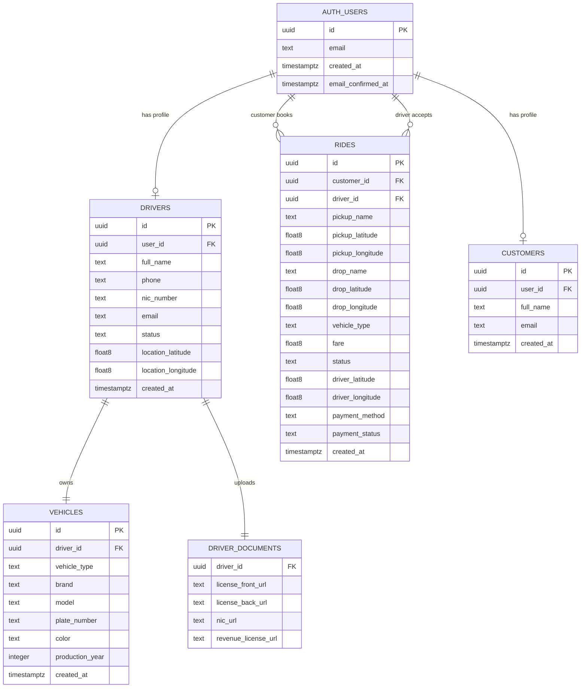
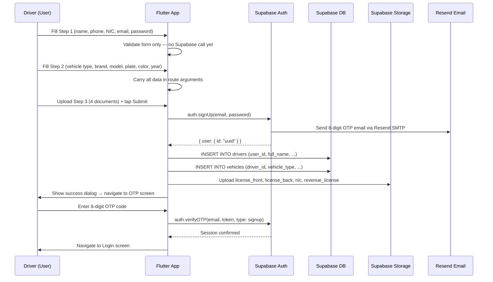
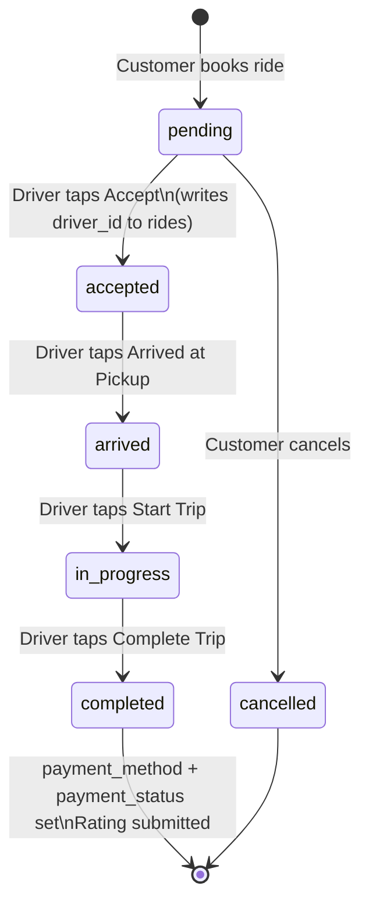

# TaxiGo — Use Case Diagram & ER Diagram

> All field names, relationships, and flows in this document are derived directly
> from the TaxiGo codebase (`driver_home_page.dart`, `customer_home_page.dart`,
> `document_upload_page.dart`, `driver_model.dart`, `vehicle_model.dart`, etc.)
> and the Supabase database schema.

---

## 1. Use Case Diagram

### Actors

| Actor | Description |
|---|---|
| **Customer** | A registered user who books rides via the customer app |
| **Driver** | A registered & approved driver who accepts and fulfils rides |
| **Admin** | Platform administrator who approves/rejects driver applications |
| **Supabase System** | The backend — handles Auth OTP, Realtime events, Storage, and RLS |

---

### Use Cases by Actor

#### Customer
| Use Case | Description |
|---|---|
| Register / Sign In | Create account or log in with email + password |
| Search Address | Type an address; Nominatim geocodes it to lat/lng |
| Select Vehicle Type | Choose Tuk-Tuk, Sedan, SUV, or Mini Van |
| View Fare Estimate | App calculates `Base Fare + (Per-KM Rate × Distance)` via OSRM |
| Book a Ride | Insert a `rides` row with status `pending` |
| Track Driver Live | Stream driver GPS from `rides.driver_latitude/longitude` in real time |
| Cancel Ride | Update ride status to `cancelled` |
| Select Payment Method | Choose Cash or Card after ride completes |
| Rate the Driver | Submit a star rating after payment |

#### Driver
| Use Case | Description |
|---|---|
| Register (Multi-Step) | Submit personal info, vehicle details, and upload documents |
| Verify Email (OTP) | Enter 8-digit OTP sent via Resend SMTP to confirm account |
| Go Online / Offline | Toggle availability; writes GPS + `status: online` to `drivers` table |
| View Ride Request | Real-time popup with pickup, drop-off, fare, and vehicle type |
| Accept or Decline Ride | Updates `rides.status` to `accepted` and writes `rides.driver_id` |
| Navigate to Pickup | App fetches OSRM route from driver GPS to pickup pin |
| Mark Arrived at Pickup | Updates `rides.status` to `arrived` |
| Start Trip | Updates `rides.status` to `in_progress` |
| Complete Trip | Updates `rides.status` to `completed`; triggers payment flow |
| Confirm Cash Received | Marks `rides.payment_status` to `paid` for cash rides |
| Broadcast GPS Location | Streams `location_latitude/longitude` to `drivers` table every ~3 s |

#### Admin
| Use Case | Description |
|---|---|
| Log In to Admin Portal | Separate auth flow via `/admin_login` with Supabase password auth |
| View Pending Drivers | Fetches all `drivers` rows where `status = pending_approval` |
| View Driver Documents | Generates signed URLs from `driver-documents` Storage bucket |
| Approve Driver | Updates `drivers.status` to `approved` |
| Reject Driver | Updates `drivers.status` to `rejected` |
| Refresh Dashboard | Re-fetches the pending list |
| Log Out | Signs out the admin session |

#### Supabase System (automated)
| Use Case | Description |
|---|---|
| Send OTP Email | Fires on `auth.signUp()` via Resend Custom SMTP |
| Verify OTP Token | Validates 8-digit token via `auth.verifyOTP()` |
| Enforce RLS Policies | Blocks/allows DB reads-writes based on `auth.uid()` |
| Broadcast Realtime | Pushes `postgres_changes` to subscribed Flutter clients |
| Store Documents | Saves uploaded files to `driver-documents` bucket |
| Generate Signed URLs | Issues time-limited (1-hour) secure URLs for admin document review |

---

### Mermaid Use Case Diagram

```mermaid
graph TD
    subgraph Actors
        C([👤 Customer])
        D([🚗 Driver])
        A([🛡️ Admin])
        S([⚙️ Supabase System])
    end

    subgraph AUTH["🔐 Authentication"]
        UC1[Register with Email + Password]
        UC2[Verify Email via 8-Digit OTP]
        UC3[Sign In]
        UC4[Admin Portal Login]
        UC5[Send OTP via Resend SMTP]
        UC6[Validate OTP Token]
    end

    subgraph BOOKING["📍 Ride Booking"]
        UC7[Search & Geocode Address]
        UC8[Select Vehicle Type]
        UC9[View Fare Estimate]
        UC10[Book a Ride]
        UC11[Cancel Ride]
    end

    subgraph TRACKING["🗺️ Live Tracking"]
        UC12[Broadcast Driver GPS]
        UC13[Track Driver on Map]
        UC14[Display Route via OSRM]
    end

    subgraph LIFECYCLE["🔄 Ride Lifecycle"]
        UC15[Accept Ride Request]
        UC16[Mark Arrived at Pickup]
        UC17[Start Trip]
        UC18[Complete Trip]
    end

    subgraph PAYMENT["💳 Payment"]
        UC19[Customer Selects Payment Method]
        UC20[Confirm Cash Received]
        UC21[Rate Driver]
    end

    subgraph APPROVAL["✅ Driver Approval"]
        UC22[View Pending Applications]
        UC23[View Driver Documents]
        UC24[Generate Signed Storage URLs]
        UC25[Approve Driver]
        UC26[Reject Driver]
    end

    subgraph REGISTRATION["📋 Driver Registration"]
        UC27[Submit Personal Info - Step 1]
        UC28[Submit Vehicle Details - Step 2]
        UC29[Upload Documents - Step 3]
        UC30[Trigger auth.signUp + Email OTP]
    end

    %% Customer connections
    C --> UC1
    C --> UC3
    C --> UC7
    C --> UC8
    C --> UC9
    C --> UC10
    C --> UC11
    C --> UC13
    C --> UC19
    C --> UC21

    %% Driver connections
    D --> UC1
    D --> UC2
    D --> UC3
    D --> UC27
    D --> UC28
    D --> UC29
    D --> UC12
    D --> UC15
    D --> UC16
    D --> UC17
    D --> UC18
    D --> UC20

    %% Admin connections
    A --> UC4
    A --> UC22
    A --> UC23
    A --> UC25
    A --> UC26

    %% Supabase System connections
    UC1  --> UC30
    UC30 --> UC5
    UC2  --> UC6
    UC12 --> S
    UC10 --> S
    UC15 --> S
    UC18 --> S
    UC23 --> UC24
    UC24 --> S
    S    --> UC5
    S    --> UC6

    %% Include relationships
    UC13 -.->|"uses"| UC14
    UC10 -.->|"triggers"| UC12
```



---

## 2. Entity-Relationship Diagram

### Entities & Attributes

---

#### `auth.users` *(Supabase managed)*
This table is managed entirely by Supabase Auth. It is the source of truth for all user identities.

| Column | Type | Constraint | Description |
|---|---|---|---|
| `id` | UUID | **PK** | Auto-generated user identity |
| `email` | text | UNIQUE | User's email address |
| `created_at` | timestamptz | NOT NULL | Account creation time |
| `email_confirmed_at` | timestamptz | nullable | Set when OTP is verified |

---

#### `drivers`
Stores one row per registered driver. Created in Step 3 of the registration flow after `auth.signUp()` succeeds.

| Column | Type | Constraint | Description |
|---|---|---|---|
| `id` | UUID | **PK**, default gen_random_uuid() | Driver profile primary key |
| `user_id` | UUID | **FK → auth.users.id**, UNIQUE | Links to the Auth identity |
| `full_name` | text | NOT NULL | Driver's full name |
| `phone` | text | NOT NULL | Mobile number |
| `nic_number` | text | NOT NULL | National Identity Card number |
| `email` | text | nullable | Driver's email (convenience copy) |
| `status` | text | NOT NULL, default `pending_approval` | `pending_approval` → `approved` → `online` / `rejected` |
| `location_latitude` | float8 | nullable | Live GPS latitude (null when offline) |
| `location_longitude` | float8 | nullable | Live GPS longitude (null when offline) |
| `created_at` | timestamptz | default now() | Row creation timestamp |

**Status values used in code:**
- `pending_approval` — just registered, awaiting admin review
- `approved` — admin approved, can go online
- `online` — currently active and broadcasting GPS
- `rejected` — application rejected by admin

---

#### `vehicles`
One vehicle per driver. Created immediately after the `drivers` row in Step 3.

| Column | Type | Constraint | Description |
|---|---|---|---|
| `id` | UUID | **PK**, default gen_random_uuid() | Vehicle primary key |
| `driver_id` | UUID | **FK → drivers.id** | Which driver owns this vehicle |
| `vehicle_type` | text | NOT NULL | `tuk_tuk`, `sedan`, `suv`, `van` |
| `brand` | text | NOT NULL | e.g., Toyota, Suzuki, Bajaj |
| `model` | text | NOT NULL | e.g., Axio, Alto, RE Three-Wheeler |
| `plate_number` | text | NOT NULL | Vehicle licence plate |
| `color` | text | NOT NULL | Vehicle colour |
| `production_year` | integer | NOT NULL | Manufacturing year |
| `created_at` | timestamptz | default now() | Row creation timestamp |

---

#### `rides`
Central transaction table. Created by the customer on booking, updated throughout the ride lifecycle by both driver and customer apps.

| Column | Type | Constraint | Description |
|---|---|---|---|
| `id` | UUID | **PK**, default gen_random_uuid() | Ride primary key |
| `customer_id` | UUID | **FK → auth.users.id** | Who booked the ride |
| `driver_id` | UUID | **FK → auth.users.id**, nullable | Set when driver accepts (`acceptRide`) |
| `pickup_name` | text | NOT NULL | Human-readable pickup address |
| `pickup_latitude` | float8 | NOT NULL | Geocoded pickup latitude |
| `pickup_longitude` | float8 | NOT NULL | Geocoded pickup longitude |
| `drop_name` | text | NOT NULL | Human-readable destination |
| `drop_latitude` | float8 | NOT NULL | Geocoded destination latitude |
| `drop_longitude` | float8 | NOT NULL | Geocoded destination longitude |
| `vehicle_type` | text | NOT NULL | Requested vehicle category |
| `fare` | float8 | NOT NULL | Pre-calculated fare in LKR |
| `status` | text | NOT NULL, default `pending` | Ride lifecycle state (see below) |
| `driver_latitude` | float8 | nullable | Driver's live GPS latitude (streamed) |
| `driver_longitude` | float8 | nullable | Driver's live GPS longitude (streamed) |
| `payment_method` | text | nullable | `cash` or `card` — set post-completion |
| `payment_status` | text | nullable, default `pending` | `pending` or `paid` |
| `created_at` | timestamptz | default now() | When the ride was booked |

**`status` lifecycle:**
```
pending → accepted → arrived → in_progress → completed
                                            ↘ cancelled
```

---

#### `customers`
Profile table for customer-facing display data, linked to `auth.users`.

| Column | Type | Constraint | Description |
|---|---|---|---|
| `id` | UUID | **PK**, default gen_random_uuid() | Profile primary key |
| `user_id` | UUID | **FK → auth.users.id**, UNIQUE | Links to the Auth identity |
| `full_name` | text | NOT NULL | Customer's display name |
| `email` | text | nullable | Convenience copy of email |
| `created_at` | timestamptz | default now() | Profile creation time |

---

#### `driver-documents` *(Supabase Storage bucket)*
Not a SQL table — a file storage bucket. Files are addressed by path:

```
driver-documents/
  └── {drivers.id}/
        ├── license_front.{jpg|jpeg|png|pdf}
        ├── license_back.{jpg|jpeg|png|pdf}
        ├── nic.{jpg|jpeg|png|pdf}
        └── revenue_license.{jpg|jpeg|png|pdf}
```

Accessed via **signed URLs** (1-hour TTL) generated in the Admin Dashboard.

---

### Cardinality Summary

| Relationship | Cardinality | Description |
|---|---|---|
| `auth.users` → `drivers` | **1 : 0..1** | One auth user may have at most one driver profile |
| `auth.users` → `customers` | **1 : 0..1** | One auth user may have at most one customer profile |
| `drivers` → `vehicles` | **1 : 1** | Each driver has exactly one vehicle registered |
| `auth.users` (customer) → `rides` | **1 : N** | One customer can book many rides over time |
| `auth.users` (driver) → `rides` | **1 : N** | One driver can accept many rides over time |
| `drivers` → `driver-documents` | **1 : 4** | Each driver has exactly 4 document slots in Storage |

---

### Mermaid ER Diagram



---

## 3. Registration Flow (Sequence Summary)



---

## 4. Ride Lifecycle (State Machine)


